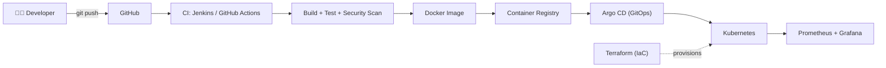

 

---

## 👨‍💻 About Me

I'm a DevOps and Cloud Engineer who likes the part of software most people never see: the pipelines, infrastructure, and monitoring that keep applications running.

- 🔭 Completed a 6-month DevOps and Cloud Engineer internship, including a real **AWS-to-Azure migration** with Terraform and GitHub Actions
- 🛠️ Building hands-on **Kubernetes, GitOps, and DevSecOps** projects
- 🌱 Currently deepening my skills in **Kubernetes, Terraform, and cloud security**
- 🎓 Pursuing B.Sc. in Information Technology (expected 2027)
- 💬 Ask me about **CI/CD, Infrastructure as Code, and cloud migration**
- ⚡ Fun fact: I run a full Kubernetes GitOps pipeline on my laptop using an AWS emulator, so it costs nothing to run

---

## 🛠️ Tech Stack

**☁️ Cloud and IaC**

**📦 Containers and Orchestration**

**🔄 CI/CD and GitOps**

**📊 Monitoring and Security**

**🧰 Basics**

---

## 📂 Featured Projects

### 🔹 [GitOps DevOps Dashboard](https://github.com/itsakrana/gitops-devops-dashboard)
An end-to-end GitOps delivery pipeline for a full-stack application (React, Node.js, MongoDB), where every change flows from Git to a running Kubernetes cluster automatically.

`Developer → GitHub → Jenkins → DockerHub → Kubernetes → Argo CD`

- Jenkins pipeline builds Docker images and pushes them to DockerHub on every commit
- Argo CD uses a parent app to deploy the frontend, backend, database, and monitoring stack, keeping the cluster in sync with Git
- Prometheus and Grafana provide metrics and dashboards
- **Stack:** `Jenkins` `Docker` `Kubernetes` `Argo CD` `Prometheus` `Grafana` `React` `Node.js` `MongoDB`

### 🔹 [Secure CI/CD Pipeline with DevSecOps](https://github.com/itsakrana/wanderlust)
A Jenkins pipeline that scans code, dependencies, and images before anything is deployed.

- SonarQube Quality Gates, Trivy image scanning, and OWASP Dependency-Check stop insecure builds
- Containerized with Docker for consistent environments
- **Result:** deployment failures reduced by **25%**
- **Stack:** `Jenkins` `SonarQube` `Trivy` `OWASP Dependency-Check` `Docker`

### 🔹 [Helm-Based Kubernetes Release Management](https://github.com/itsakrana/NotePad-Project)
Reusable Helm charts that make Kubernetes releases repeatable across environments.

- Parameterized configuration with `values.yaml`, plus automated upgrades and rollbacks
- Deployment through Argo CD, with Prometheus and Grafana monitoring
- **Result:** configuration errors reduced by **35%**
- **Stack:** `Kubernetes` `Helm` `Argo CD` `Jenkins` `Prometheus` `Grafana`

### 🔹 [DevOps Pipeline for Kubernetes Microservices](https://github.com/itsakrana/k8s-microservices-terraform)
A fully local DevOps environment for three FastAPI microservices, using Floci (an AWS emulator) so it needs no cloud account and costs nothing.

- Terraform modules provision AWS-compatible VPC, ECR, EKS, S3, and DynamoDB, with services deployed to kind using Helm
- GitOps with Argo CD, observability with Prometheus and Grafana, and strict Kubernetes NetworkPolicies
- CI validation with GitHub Actions
- **Stack:** `Terraform` `Floci` `Docker` `kind` `Helm` `Argo CD` `Prometheus` `Grafana` `GitHub Actions`

---

## 🎓 Certifications

---

## 🔄 How I Ship Software

---

## 🎯 What I Focus On

| Area | What I do | Tools |
|------|-----------|-------|
| ☁️ **Cloud and IaC** | Provision and migrate infrastructure as code | Terraform, Azure, AWS |
| 🔁 **CI/CD** | Automate build, test, and deployment | GitHub Actions, Jenkins |
| ☸️ **Kubernetes and GitOps** | Deploy and keep clusters in sync with Git | Kubernetes, Helm, Argo CD |
| 🛡️ **DevSecOps** | Add code and image scanning inside the pipeline | SonarQube, Trivy, OWASP Dependency-Check |
| 📊 **Observability** | Monitor systems with metrics and dashboards | Prometheus, Grafana |

---

## 🧭 How I Work

- **Automate it:** if I do something twice, I script it
- **Make deployments boring:** repeatable, reviewed, and easy to roll back
- **Shift security left:** scan in the pipeline, not after release

---

## 🌱 Currently Learning

- Kubernetes in depth
- Advanced Terraform
- Cloud security

---

## 📫 Let's Connect

I'd be glad to hear about DevOps and Cloud opportunities. Message me on [LinkedIn](https://www.linkedin.com/in/ankit-rana-3a2a05379/) or email **akrana675@gmail.com**.

